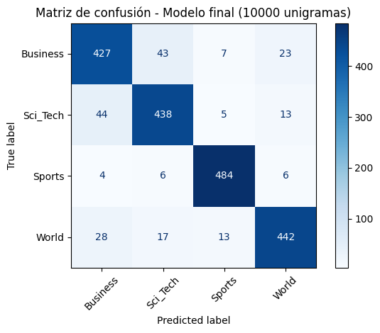

# Clasificador supervisado con TF-IDF: AG News

Pipeline de clasificación supervisada de noticias en cuatro categorías (Business, Sci_Tech, Sports y World) sobre el dataset AG News, usando TF-IDF y Regresión Logística.

**Resultado final:** accuracy de 0.895 y F1 macro de 0.895 sobre el conjunto de prueba (2000 noticias).

## Archivos

- `Clasificador_supervisado_con_TF_IDF_Angie_Avendaño.ipynb`: notebook con el pipeline completo.
- `matriz_confusion_final.png`: matriz de confusión del modelo final.
- `requirements.txt`: versiones de las librerías utilizadas.

## Cómo ejecutarlo

1. Descargá `ag_news_train.csv` y `ag_news_test.csv` y subilos a Colab, o colocá los archivos en la misma carpeta que el notebook.
2. Abrí el notebook en Google Colab y ejecutá **Entorno de ejecución → Reiniciar y ejecutar todo**.

## Metodología

1. **Preprocesamiento:** minúsculas, eliminación de números y puntuación, eliminación de stop-words y lematización con NLTK.
2. **Vectorización:** `TfidfVectorizer` ajustado solo con el conjunto de entrenamiento (`fit_transform`) y aplicado al de prueba (`transform`), para evitar data leakage.
3. **Selección de hiperparámetros:** se probaron `max_features` (5000, 10000, 20000) y `ngram_range` ((1,1) y (1,2)) con Regresión Logística.
4. **Modelo final:** Regresión Logística con 10000 unigramas.

## Justificación del modelo

Se eligió Regresión Logística porque es un clasificador lineal que funciona bien sobre matrices TF-IDF dispersas, es eficiente, permite interpretar los pesos de cada término y entrega probabilidades de clase. Como referencia, Naive Bayes sobre la misma configuración obtuvo un accuracy de 0.889, por debajo de Regresión Logística (0.895).

## Configuración del vectorizador

- `max_features=10000`: limita el vocabulario, lo que reduce el consumo de memoria.
- `ngram_range=(1, 1)`: unigramas. En el experimento, los bigramas no mejoraron el rendimiento.
- `sublinear_tf=True`: escala logarítmica de la frecuencia, que reduce el peso de términos repetidos.
- `min_df=2`: ignora términos que aparecen en un solo documento.

## Resultados

| Clase | Precision | Recall | F1 | Soporte |
|---|---|---|---|---|
| Business | 0.849 | 0.854 | 0.851 | 500 |
| Sci_Tech | 0.869 | 0.876 | 0.873 | 500 |
| Sports | 0.951 | 0.968 | 0.959 | 500 |
| World | 0.913 | 0.884 | 0.898 | 500 |
| **Macro avg** | 0.896 | 0.895 | 0.895 | 2000 |

## Análisis de errores

De las 2000 noticias de prueba, el modelo clasifica incorrectamente 210.

- **Business y Sci_Tech** son las categorías más difíciles de separar: entre ambas suman 87 de los 210 errores (≈41%). Las confusiones son casi simétricas (43 y 44 casos), lo que sugiere solapamiento de vocabulario: muchas noticias tecnológicas tratan sobre resultados financieros o acuerdos empresariales.
- **Sports** es la categoría mejor predicha, con un recall de 0.968. Su vocabulario es muy específico.
- **World** se confunde sobre todo con **Business** (28 casos), probablemente por noticias de economía internacional.
